<div align="center">


# CampusConnect

### *Next-Generation Centralized College Event & Campus Life Management Platform*

[](https://reactnative.dev/)
[](https://expo.dev/)
[](https://www.typescriptlang.org/)
[](https://nodejs.org/)
[](https://www.mongodb.com/)
[](https://razorpay.com/)

<p align="center">
  <a href="#-project-overview">Overview</a> •
  <a href="#-mobile-application-showcase">Showcase</a> •
  <a href="#-live-application-demo-video">Demo Video</a> •
  <a href="#-core-modules--features">Features</a> •
  <a href="#-system-architecture">Architecture</a> •
  <a href="#-application-workflows">Workflows</a> •
  <a href="#-database-schema">Database</a> •
  <a href="#-api-reference">API Docs</a> •
  <a href="#-installation--setup">Quickstart</a>
</p>

</div>

---

## 📱 Mobile Application Showcase

CampusConnect is engineered from the ground up as a **cross-platform React Native mobile application**, providing a unified, multi-tiered portal for university administrators, departmental heads, student coordinators, and attendees.

<div align="center">
  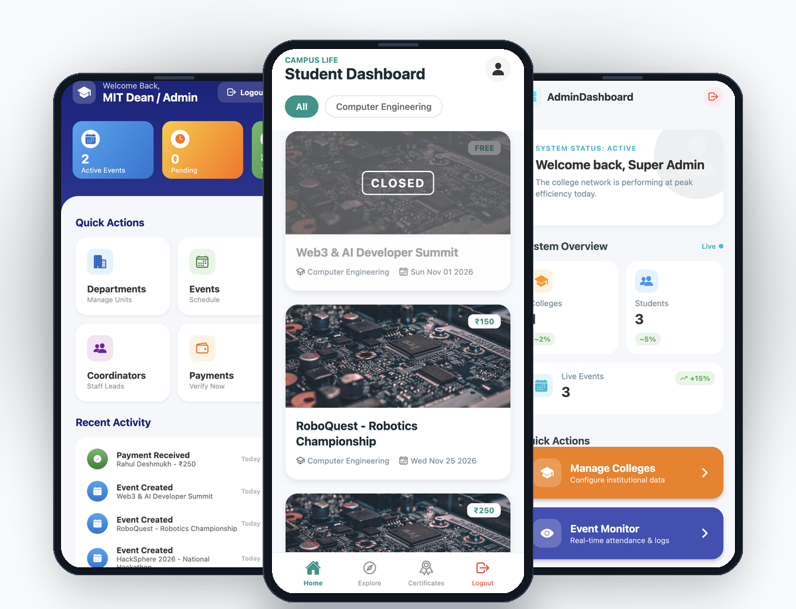
  <p><em>Triple-device mobile showcase presenting College Administration, Student Discovery & Ticketing, and Super Admin Governance interfaces.</em></p>
</div>

### 🎬 Live Application Demo Video

Experience the real mobile application workflow in action—including authentication, student event exploration, Razorpay payment flow, coordinator attendance validation, and instant PDF certificate generation:

<div align="center">
  <a href="docs/presentation_video.mp4">
    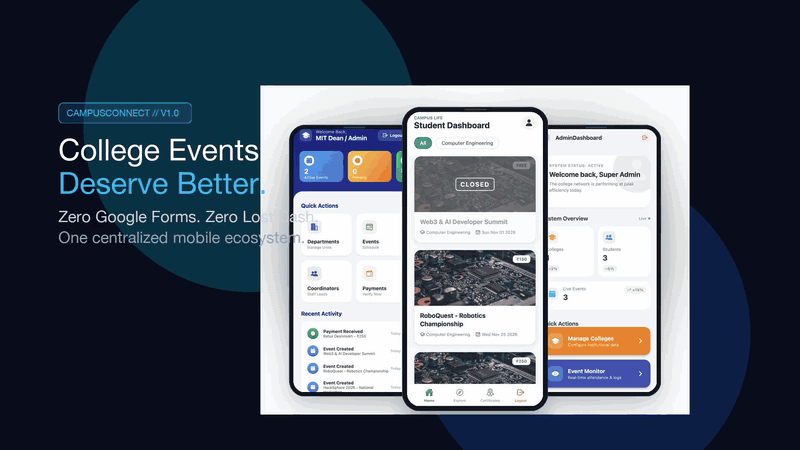
  </a>
  <p>
    <sub>▶️ <strong>Interactive Demo Window:</strong> Click the preview above or <a href="docs/presentation_video.mp4"><strong>Click here to open the full HD video (MP4)</strong></a>.</sub>
  </p>
</div>

---

## 📑 Table of Contents

- [📌 Project Overview](#-project-overview)
- [✨ Key Capabilities](#-key-capabilities)
- [📱 Mobile Application Showcase](#-mobile-application-showcase)
- [🎬 Live Application Demo Video](#-live-application-demo-video)
- [🧩 Core Modules & Implemented Features](#-core-modules--features)
  - [1. Multi-Tier Authentication & Onboarding](#1-multi-tier-authentication--onboarding)
  - [2. Super Admin Control Center](#2-super-admin-control-center)
  - [3. College Administration Dashboard](#3-college-administration-dashboard)
  - [4. Event Coordinator Operations](#4-event-coordinator-operations)
  - [5. Student Experience & Discovery Feed](#5-student-experience--discovery-feed)
  - [6. Digital Event Ticketing & Details](#6-digital-event-ticketing--details)
  - [7. Automated PDF Certificate Issuance](#7-automated-pdf-certificate-issuance)
- [👥 Role-Based Access Control (RBAC)](#-role-based-access-control-rbac)
- [🛠️ Technology Stack](#-technology-stack)
- [🏛️ System Architecture](#-system-architecture)
- [🔄 Application Workflows](#-application-workflows)
  - [Authentication & Role Routing](#authentication--role-routing)
  - [Event Registration & Payment Pipeline](#event-registration--payment-pipeline)
  - [Attendance Verification & Certificate Pipeline](#attendance-verification--certificate-pipeline)
- [🗄️ Database Architecture & Data Models](#-database-architecture--data-models)
- [📡 API Documentation Reference](#-api-documentation-reference)
- [📂 Project Directory Structure](#-project-directory-structure)
- [🚀 Installation & Setup Guide](#-installation--setup-guide)
- [🔐 Environment Variables](#-environment-variables)
- [🛡️ Security Implementation](#-security-implementation)
- [🧪 Quality Assurance & Testing](#-quality-assurance--testing)
- [📈 Future Roadmap](#-future-roadmap)
- [🤝 Contributing Guidelines](#-contributing-guidelines)
- [📄 License](#-license)

---

## 📌 Project Overview

### Problem Statement
In traditional higher education institutions, organizing collegiate events (symposiums, technical hackathons, cultural festivals, sports championships, and workshops) is hampered by fragmented operational silos. Event registrations often rely on uncoordinated Google Forms, manual cash receipts or disjointed UPI screenshots, physical attendance sheets prone to tampering, and sluggish post-event certificate distribution via bulk email attachments.

### Solution
**CampusConnect** solves this by establishing a centralized mobile ecosystem that connects every campus stakeholder:
1. **Universities & Colleges**: Establish institutional presence, register academic departments, and delegate authority.
2. **Faculty & Student Coordinators**: Create event schedules, manage ticket quotas, verify payments (online/offline), track real-time check-ins, and issue cryptographically verifiable certificates.
3. **Students**: Browse college events across departments, register seamlessly with Razorpay payments, access digital entry passes, and directly download PDF certificates of achievement.
4. **Super Administrators**: Oversee network-wide operations, audit aggregate institutional revenue, and monitor platform health.

---

## ✨ Key Capabilities

- **Role-Based Navigation**: Dynamic UI rendering driven by React Navigation and JWT role claims (`admin`, `college`, `coordinator`, `student`).
- **Hybrid Payment Processing**: Seamless dual-channel payments integrating Razorpay for instantaneous online orders alongside manual coordinator reconciliation for offline cash dues.
- **Dynamic Certificate Engine**: Headless PDF generation via `PDFKit` that renders personalized certificates and delivers them directly into the mobile app and via Nodemailer SMTP.
- **Real-Time Attendance Reconciliation**: Coordinators mark attendance during live events to immediately unlock certificate generation eligibility.
- **Institutional Multi-Tenancy**: Colleges operate their own departments, events, and coordinator teams with strict logical data partitioning.

---

## 🧩 Core Modules & Implemented Features

### 1. Multi-Tier Authentication & Onboarding

<div align="center">
  <table>
    <tr>
      <td width="50%" align="center">
        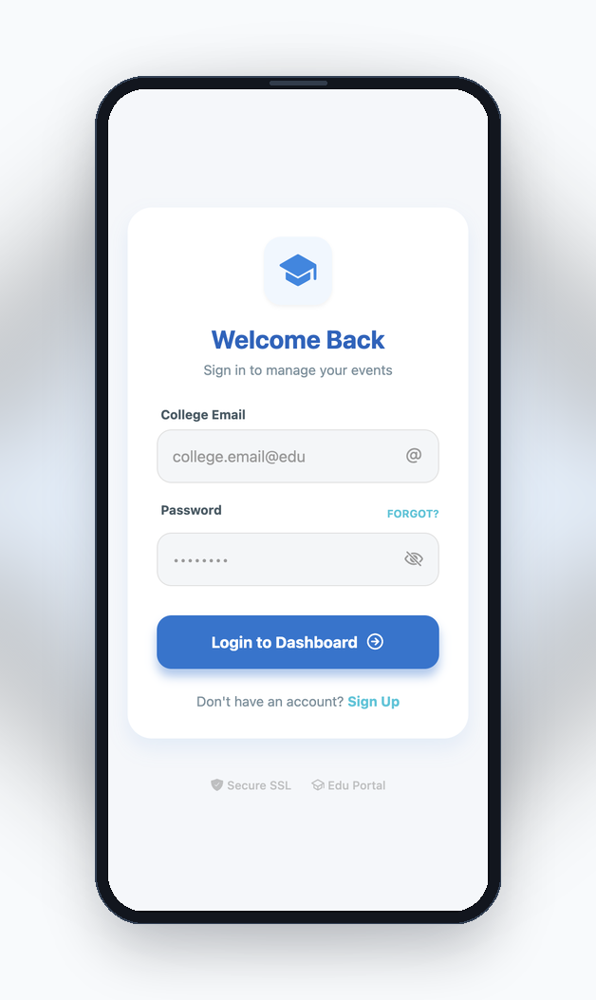
        <br/>
        <strong>Login Portal</strong>
      </td>
      <td width="50%" align="center">
        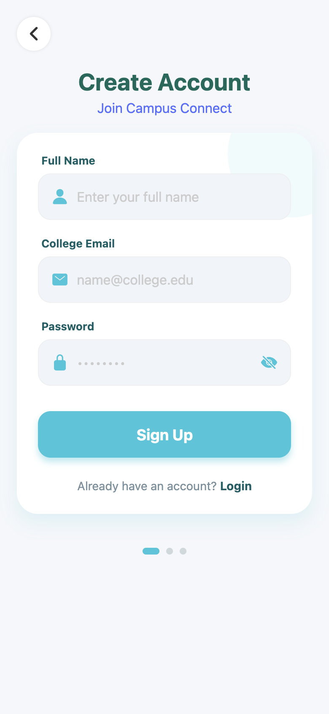
        <br/>
        <strong>Student Registration</strong>
      </td>
    </tr>
  </table>
</div>

- **Secure Login**: Validates institutional credentials against Bcrypt password hashes, issues 7-day signed JWT tokens, and routes users to their specific role stack.
- **Account Registration**: Allows students to register with validated email addresses and institutional affiliation.
- **State Management**: Persists authentication session tokens securely via `expo-secure-store` on mobile devices and `localStorage` on responsive web clients.

---

### 2. Super Admin Control Center

<div align="center">
  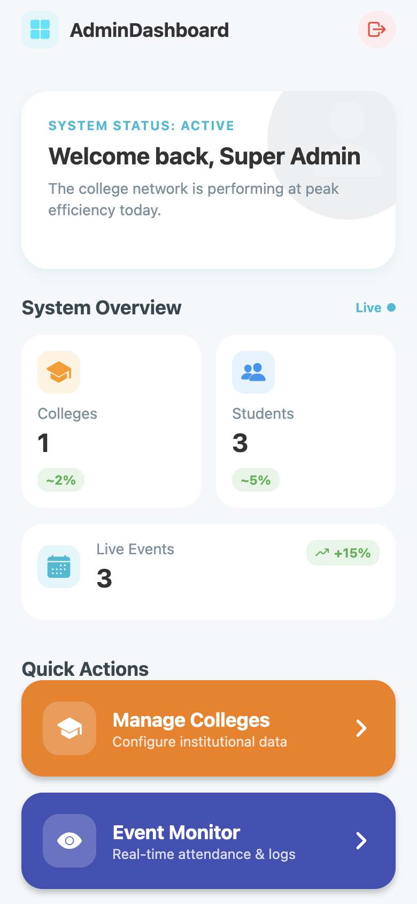
  <p><em>Super Admin Dashboard featuring live counts for colleges, registered students, active events, and navigation shortcuts.</em></p>
</div>

- **Institutional Analytics**: Real-time aggregation of registered colleges, active students, and scheduled events across the entire network.
- **College Onboarding**: Provision new educational institutions with designated administrative credentials.
- **System Reports**: Audit financial throughput, total event registrations, and global system logs via MongoDB aggregation pipelines (`/api/admin/reports`).

---

### 3. College Administration Dashboard

<div align="center">
  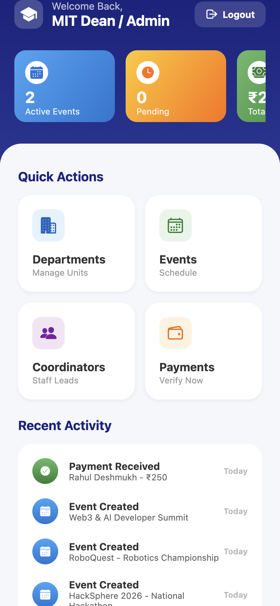
  <p><em>College Admin overview for managing departments, event schedules, staff coordinators, and recent financial activity.</em></p>
</div>

- **Departmental Hierarchy**: Configure and manage institutional academic branches (e.g., Computer Engineering, Mechanical, Management).
- **Coordinator Assignment**: Delegate event logistics to faculty and student leads with departmental scope.
- **Revenue Overview**: Monitor gross registration fees collected across departmental events.

---

### 4. Event Coordinator Operations

<div align="center">
  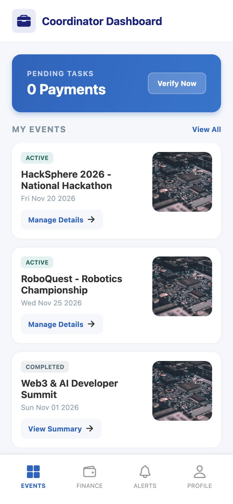
  <p><em>Coordinator Workspace displaying assigned competitions, payment verification alerts, and attendee check-in management.</em></p>
</div>

- **Event Scheduling & Configuration**: Define event venues, participant capacity limits, registration fees, and dates.
- **Payment Verification**: Reconcile offline student cash payments and approve registration tickets.
- **Attendance Check-In**: Mark live student attendance on-site to validate participation prior to certificate distribution.

---

### 5. Student Experience & Discovery Feed

<div align="center">
  <table>
    <tr>
      <td width="50%" align="center">
        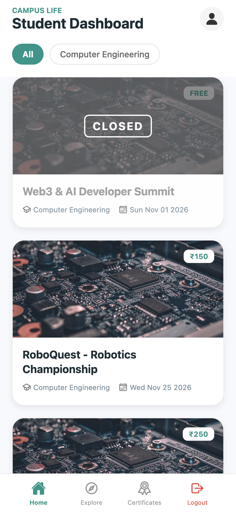
        <br/>
        <strong>Campus Life Feed</strong>
      </td>
      <td width="50%" align="center">
        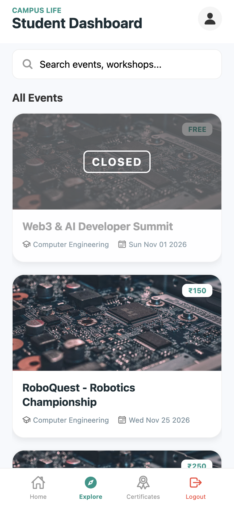
        <br/>
        <strong>Search & Filter</strong>
      </td>
    </tr>
  </table>
</div>

- **Interactive Department Filter Chips**: Filter live campus competitions, seminars, and workshops by academic department with a single tap.
- **Real-Time Search**: Instant keyword discovery for upcoming events and hackathons across departments.
- **Status Badges**: Distinct visual indicators for pricing (`FREE`, `₹150`, `₹250`) and event availability status (`ACTIVE`, `CLOSED`).

---

### 6. Digital Event Ticketing & Details

<div align="center">
  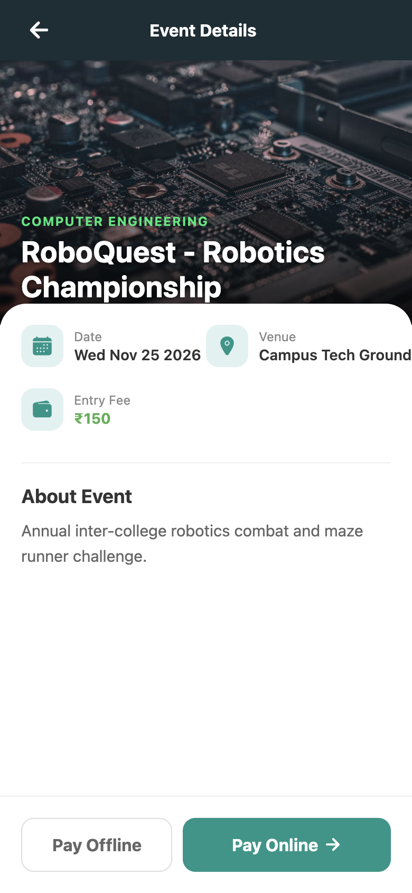
  <p><em>Event details showing venue, schedule, entry fee, detailed agenda, and dual checkout actions (Online / Offline).</em></p>
</div>

- **Event Insights**: Detailed inspection of venue locations, start dates, schedules, and entry requirements.
- **Dual Checkout System**:
  - **Pay Online**: Triggers Razorpay payment order initialization with HMAC cryptographic signature validation.
  - **Pay Offline**: Generates a pending offline registration for physical cash payment to event coordinators.

---

### 7. Automated PDF Certificate Issuance

<div align="center">
  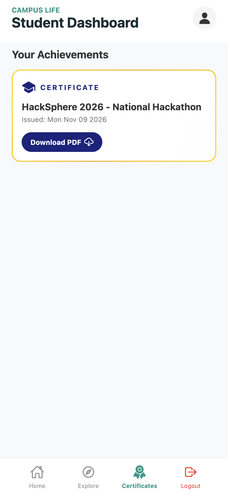
  <p><em>Student Achievements tab displaying awarded event certificates with direct PDF download integration.</em></p>
</div>

- **Headless Certificate Generation**: Backend PDFKit engine generates customized, publication-grade completion certificates upon event conclusion.
- **Validation Guardrails**: Certificates are only unlocked when **`paymentStatus === 'paid'`** AND **`attendance === true`**.
- **Delivery**: Accessible directly inside the student mobile wallet and delivered to the attendee's email via Nodemailer.

---

## 👥 Role-Based Access Control (RBAC)

| User Role | Target User Persona | Primary Access & Permissions | Key Dashboard Screens |
|---|---|---|---|
| **`admin`** | University Chancellor / Super Admin | Full platform governance; creates colleges; audits global revenue; reviews aggregate telemetry. | `AdminDashboard`, `CollegeList`, `EventMonitor`, `SystemReports` |
| **`college`** | College Dean / Institutional Head | Manages campus departments; appoints coordinators; monitors campus-wide event schedules and income. | `CollegeDashboard`, `ManageDepartments`, `ManageEvents`, `ManageCoordinators`, `PaymentHistory` |
| **`coordinator`** | Faculty / Student Event Head | Schedules events; updates venue/capacity; reconciles offline payments; marks student attendance; triggers certificates. | `CoordDashboard`, `EventAttendance`, `VerifyPayments`, `EventRegistrations` |
| **`student`** | Enrolled College Student | Discovers events; registers via Razorpay / cash; tracks personal schedule; downloads verified certificates. | `StudentDashboard`, `EventDetails`, `MyCertificates`, `ProfileScreen` |

---

## 🛠️ Technology Stack

| Layer | Technologies & Libraries | Version | Purpose in Project |
|---|---|---|---|
| **Mobile Frontend** | **React Native** | `0.81.5` | Cross-platform mobile native UI framework |
| | **Expo SDK** | `~54.0.31` | Universal mobile application runtime and tooling |
| | **TypeScript** | `~5.9.2` | Static typing and interface contracts across components |
| | **React Navigation** | `7.x` | Native stack and role-based navigation container |
| | **Lucide & Vector Icons** | `^0.562.0` | High-fidelity iconography |
| | **Linear Gradient** | `^15.0.8` | Glassmorphic visual styling and gradient backdrops |
| **Backend API** | **Node.js / Express** | `5.2.1` | REST API microservices architecture |
| | **Mongoose** | `9.1.4` | Object Data Modeling (ODM) for MongoDB |
| | **Bcrypt.js** | `^3.0.3` | Cryptographic salt generation & password hashing |
| | **JSONWebToken** | `^9.0.3` | Stateless authentication tokens with role payload |
| | **Multer** | `^2.0.2` | Multipart form-data parser for media asset uploads |
| **Database** | **MongoDB** | `7.x / Atlas` | Document-oriented database for multi-tenant campus data |
| **Payments** | **Razorpay SDK** | `^2.9.6` | Order creation, webhook processing, signature verification |
| **Certificates** | **PDFKit** | `^0.17.2` | Programmatic dynamic vector PDF generation |
| | **Nodemailer** | `^7.0.12` | SMTP transactional email notification service |

---

## 🏛️ System Architecture

The following diagram illustrates how the React Native mobile application interfaces with the Express.js API layer, database, and external third-party integrations:

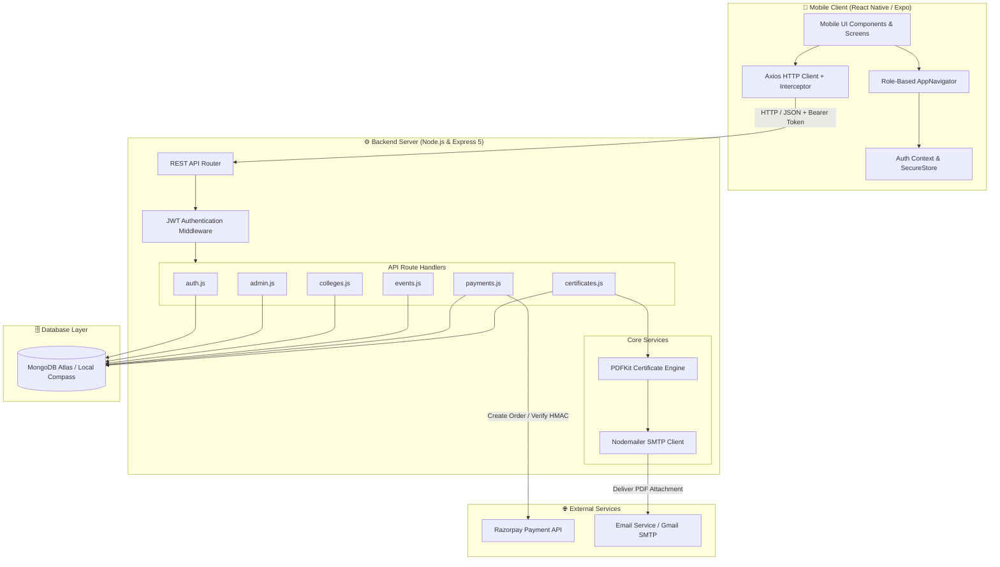

---

## 🔄 Application Workflows

### Authentication & Role Routing

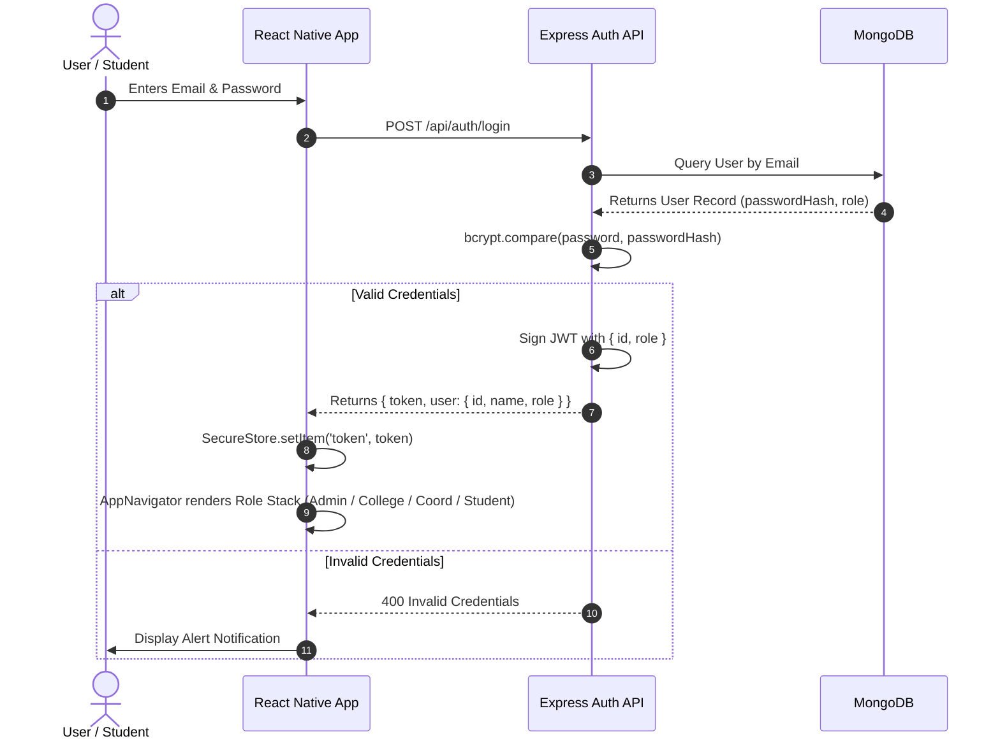

---

### Event Registration & Payment Pipeline

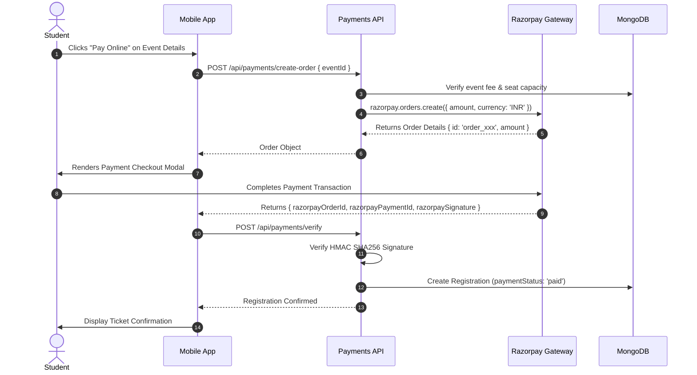

---

### Attendance Verification & Certificate Pipeline

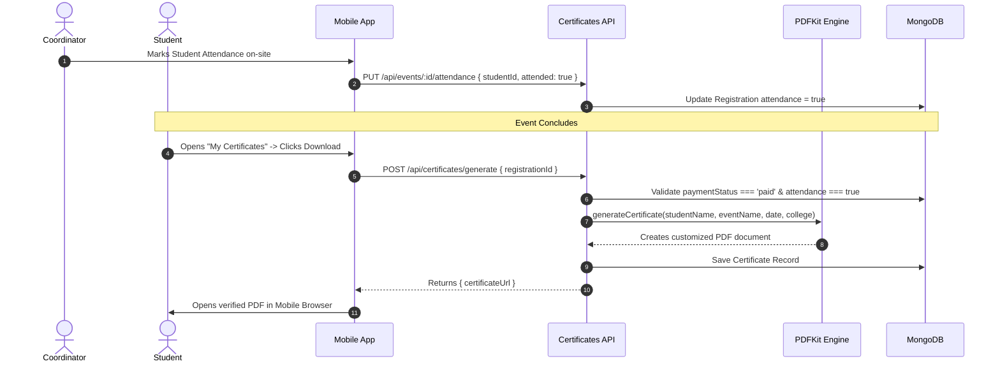

---

## 🗄️ Database Architecture & Data Models

CampusConnect uses MongoDB with structured Mongoose schemas maintaining logical relationships:

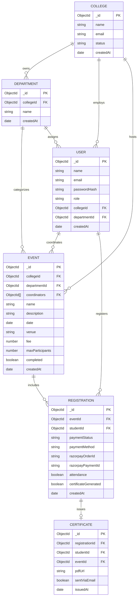

---

## 📡 API Documentation Reference

All endpoints are hosted under `/api`. Protected routes require the JWT passed in the `x-auth-token` HTTP header.

### Authentication (`/api/auth`)
| Method | Endpoint | Description | Access | Request Body |
|---|---|---|---|---|
| `POST` | `/api/auth/register` | Register a new user | Public | `{ name, email, password, role }` |
| `POST` | `/api/auth/login` | Authenticate user & issue JWT | Public | `{ email, password }` |
| `GET` | `/api/auth/user` | Fetch active user credentials | Private | *None (reads token)* |

### Admin Governance (`/api/admin`)
| Method | Endpoint | Description | Access |
|---|---|---|---|
| `GET` | `/api/admin/stats` | System counts (Colleges, Events, Students) | Private (`admin`) |
| `GET` | `/api/admin/reports` | Total revenue, aggregate registrations & breakdown | Private (`admin`) |

### Colleges & Departments (`/api/colleges`)
| Method | Endpoint | Description | Access |
|---|---|---|---|
| `GET` | `/api/colleges` | Retrieve all registered colleges | Public |
| `POST` | `/api/colleges` | Create college & assign institutional admin | Private (`admin`) |
| `GET` | `/api/colleges/:id/departments` | List departments for a college | Public |
| `POST` | `/api/colleges/:id/departments` | Create academic department | Private (`college`) |
| `GET` | `/api/colleges/:id/coordinators` | Retrieve coordinators belonging to college | Private (`college`) |
| `POST` | `/api/colleges/:id/coordinators` | Register faculty/student coordinator | Private (`college`) |

### Events (`/api/events`)
| Method | Endpoint | Description | Access |
|---|---|---|---|
| `GET` | `/api/events` | List all scheduled campus events | Public |
| `GET` | `/api/events/:id` | Fetch specific event details | Public |
| `POST` | `/api/events` | Create new event schedule | Private (`college`, `admin`) |
| `PUT` | `/api/events/:id` | Update event information | Private (`college`, `coordinator`) |
| `PUT` | `/api/events/:id/attendance` | Check-in student attendee | Private (`coordinator`) |

### Payments (`/api/payments`)
| Method | Endpoint | Description | Access |
|---|---|---|---|
| `POST` | `/api/payments/create-order` | Generate Razorpay order for ticket fee | Private (`student`) |
| `POST` | `/api/payments/verify` | Verify payment HMAC signature & confirm ticket | Private (`student`) |
| `POST` | `/api/payments/offline` | Submit pending offline cash registration | Private (`student`) |
| `PUT` | `/api/payments/verify-offline/:id` | Reconcile & approve offline cash payment | Private (`coordinator`, `college`) |

### Certificates (`/api/certificates`)
| Method | Endpoint | Description | Access |
|---|---|---|---|
| `POST` | `/api/certificates/generate` | Generate vector PDF certificate | Private (`student`, `coordinator`) |
| `GET` | `/api/certificates/my-certificates` | Fetch awarded certificates for authenticated student | Private (`student`) |

---

## 📂 Project Directory Structure

```text
College-Event-Management/
├── api/                             # Express.js REST API Backend
│   ├── index.js                     # Server entrypoint & DB connection
│   ├── middleware/
│   │   └── auth.js                  # JWT validation & role extraction
│   ├── models/                      # Mongoose Database Schemas
│   │   ├── Certificate.js           # Certificate metadata & PDF paths
│   │   ├── College.js               # College institutional profile
│   │   ├── Department.js            # Academic department units
│   │   ├── Event.js                 # Event scheduling & fee configurations
│   │   ├── Registration.js          # Student bookings, payments, attendance
│   │   └── User.js                  # Authentication & role records
│   ├── routes/                      # Modular API Controllers
│   │   ├── admin.js                 # Network governance & system reports
│   │   ├── auth.js                  # Registration & JWT token issuance
│   │   ├── certificates.js          # PDF certificate generation endpoints
│   │   ├── colleges.js              # College & department CRUD
│   │   ├── events.js                # Event publishing & attendance
│   │   └── payments.js              # Razorpay checkout & offline reconciliation
│   └── utils/
│       ├── certificateGenerator.js  # Headless PDFKit rendering engine
│       └── email.js                 # Nodemailer SMTP transporter
│
├── screens/                         # React Native Mobile Screens (19 screens)
│   ├── AdminDashboard.tsx           # Super Admin metrics & quick actions
│   ├── CollegeDashboard.tsx         # Institutional overview & revenue
│   ├── CoordDashboard.tsx           # Coordinator event desk
│   ├── StudentDashboard.tsx         # Student home feed with department filters
│   ├── EventDetails.tsx             # Ticket pricing & checkout triggers
│   ├── EventAttendance.tsx          # Real-time QR / check-in list
│   ├── MyCertificates.tsx           # Student achievement digital wallet
│   ├── LoginScreen.tsx              # Institutional login portal
│   ├── RegisterScreen.tsx           # Student onboarding form
│   └── ...                          # Additional administrative screens
│
├── context/
│   └── AuthContext.tsx              # Global authentication & user role state
├── navigation/
│   └── AppNavigator.tsx             # Native Stack role-driven navigation router
├── services/
│   ├── api.ts                       # Axios client with platform URL handling
│   ├── auth.service.ts              # Authentication persistence methods
│   └── ...                          # Additional API microservice clients
│
├── docs/
│   └── readme-assets/               # Documentation visual assets
│       ├── mobile-screenshots/      # High-resolution native mobile captures
│       ├── device-mockups/          # Realistic smartphone presentations
│       └── generated-visuals/       # Branding banners & illustrations
│
├── App.tsx                          # Root React Native component
├── app.json                         # Expo configuration manifest
├── package.json                     # Monorepo dependencies & scripts
└── tsconfig.json                    # TypeScript compiler configuration
```

---

## 🚀 Installation & Setup Guide

### 1. Prerequisites
- **Node.js**: v18.x, v20.x, or v22.x LTS installed
- **MongoDB**: Local MongoDB instance (Compass) running on `mongodb://localhost:27017` or a MongoDB Atlas connection string
- **Package Manager**: `npm` (v9+) or `yarn`

### 2. Clone Repository & Install Dependencies
```bash
git clone https://github.com/your-username/CampusConnect.git
cd CampusConnect

# Install all frontend and backend dependencies
npm install
```

### 3. Configure Environment Variables
Create a `.env` file in the project root:
```bash
cp .env.example .env
```
Fill in the parameters (refer to [Environment Variables](#-environment-variables)).

### 4. Start Local MongoDB
Ensure your local MongoDB daemon is active:
```bash
# macOS (Homebrew)
brew services start mongodb-community

# Linux (systemd)
sudo systemctl start mongod
```

### 5. Launch Backend API Server
```bash
# Run server (default port 3000)
node api/index.js
```
*Upon launch, the server automatically connects to MongoDB and seeds the default Super Admin account if it does not already exist.*

### 6. Launch Mobile Application
In a new terminal window, start Expo:
```bash
# Start Metro bundler
npm run start
```

### Running on Devices:
- **Mobile Device (Expo Go)**: Scan the generated QR code using the **Expo Go** application on iOS or Android.
- **Android Emulator**: Press `a` in the terminal to open an active Android emulator.
- **iOS Simulator**: Press `i` in the terminal to launch the Xcode iOS simulator.
- **Mobile Web Preview**: Press `w` to inspect the responsive mobile viewport in your browser (`http://localhost:8081`).

---

## 🔐 Environment Variables

The project utilizes the following environment configuration parameters:

| Variable | Description | Example / Default Value | Required |
|---|---|---|:---:|
| `PORT` | Express backend server listen port | `3000` | Yes |
| `BASE_URL` | Public API base URL (used for media URLs) | `http://localhost:3000` | Yes |
| `MONGODB_URI` | MongoDB connection string (Local or Atlas) | `mongodb://localhost:27017/campusconnect` | Yes |
| `JWT_SECRET` | Cryptographic secret for signing JWT auth tokens | `supersecretkey_change_in_production` | Yes |
| `RAZORPAY_KEY_ID` | Razorpay Merchant Key ID | `rzp_test_...` | For Online Payments |
| `RAZORPAY_KEY_SECRET` | Razorpay Merchant Secret for signature verification | `your_razorpay_secret` | For Online Payments |
| `EMAIL_SERVICE` | SMTP mail service provider | `gmail` | For Emailing Certs |
| `EMAIL_USER` | Notification sender email address | `notifications@campusconnect.edu` | For Emailing Certs |
| `EMAIL_PASS` | SMTP application-specific password | `xxxx xxxx xxxx xxxx` | For Emailing Certs |

---

## 🛡️ Security Implementation

- **Bcrypt Password Encryption**: User passwords undergo salted cryptographic hashing (10 salt rounds) prior to database persistence. Raw passwords are never stored.
- **Stateless JWT Authorization**: API routes are gated by `api/middleware/auth.js`. Incoming requests must supply a valid `x-auth-token` containing verified user IDs and role claims.
- **Payment Signature Verification**: Razorpay order payments require SHA256 HMAC signature verification (`razorpayOrderId + "|" + razorpayPaymentId`) using the merchant secret before tickets are marked as `paid`.
- **Credential Protection**: Session tokens are isolated using hardware-backed secure storage (`expo-secure-store`) on physical mobile devices.

---

## 🧪 Quality Assurance & Testing

- **Static Type Safety**: TypeScript (`tsconfig.json`) ensures strict contract adherence across screens, navigation props, and API interfaces.
- **Manual Verification Matrix**:
  - Super Admin, College Dean, Coordinator, and Student authentication flows.
  - Razorpay order creation and offline coordinator reconciliation.
  - PDF generation and storage pipeline.

### Recommended Automated Testing Additions:
```bash
# Proposed unit testing framework for components & API endpoints
npm install --save-dev jest supertest @testing-library/react-native
```

---

## 📈 Future Roadmap

- [ ] **Push Notifications**: Integrate Expo Notifications for instant event reminders and certificate announcements.
- [ ] **QR Code Ticket Scanning**: In-app camera scanner for coordinators to check in attendees via dynamic cryptographic QR passes.
- [ ] **Digital Wallet Passports**: Apple Wallet and Google Wallet `.pkpass` export for event tickets.
- [ ] **Analytics Charts**: Visual charts (Victory Native) for College Admins to inspect historical attendance trends.

---

## 🤝 Contributing Guidelines

Contributions are welcome! Please follow these steps:
1. **Fork** the repository.
2. **Create** a feature branch: `git checkout -b feature/NewFeature`.
3. **Commit** your changes: `git commit -m 'feat: Add NewFeature'`.
4. **Push** to your branch: `git push origin feature/NewFeature`.
5. **Open** a Pull Request.

---

## 📄 License

This project is licensed under the [MIT License](LICENSE).

<div align="center">
  <sub>Built with React Native, Node.js, and MongoDB. Designed for modern higher education event ecosystems.</sub>
</div>
